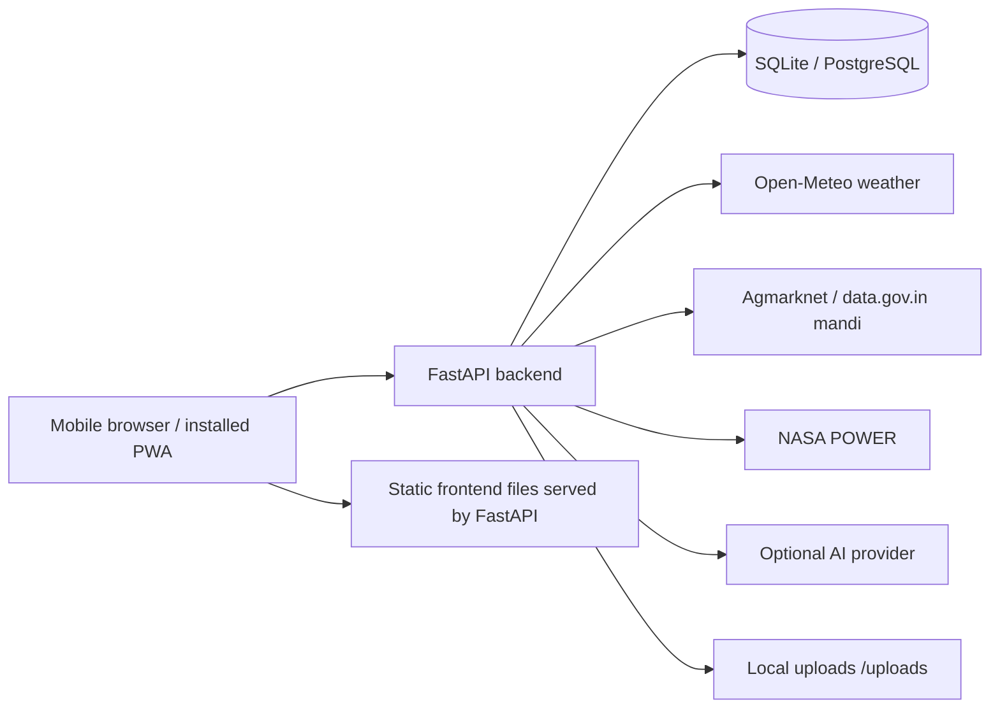

# AgriGuide — Application Documentation

**Version:** 1.1.0-live  
**Team:** Swadeshians  
**Repository:** https://github.com/supraja-kotte/swadesians  
**Live demo:** https://crown-factor-wrote-commerce.trycloudflare.com/  
**Hackathon presentation:** [PowerPoint](../AgriGuide_Hackathon_Presentation.pptx) · [PDF](../AgriGuide_Hackathon_Presentation.pdf)

> AgriGuide is a mobile-first smart farming companion for Indian farmers. It brings live weather, official mandi prices, NASA POWER field checks, verified government-scheme links, community help, equipment rental, guided farming content and voice assistance into one installable web app. No feature invents data: upstream failures are shown honestly.

---

## 1. Executive summary

| Item | Detail |
|---|---|
| Problem | Farmers must piece together weather, prices, schemes, equipment and field information from many unconnected sources, often in the wrong language. |
| Solution | One public HTTPS link that works on any phone and can be installed as a PWA. |
| Users | Farmers, equipment owners/renters, community members and administrators. |
| Data policy | Live public sources only; no seeded weather, prices, listings, contacts or benefit amounts. |
| Languages | English, Telugu, Hindi, Tamil, Marathi. |
| Backend | Python + FastAPI + SQLAlchemy, SQLite now and PostgreSQL-ready. |
| Frontend | Plain HTML, CSS and JavaScript ES modules; no build step. |
| Testing | 84 automated tests plus a one-command release check. |
| Security | HttpOnly cookies, CSRF tokens, PBKDF2 hashes, narrow CORS, security headers and server-only secrets. |

The application is a working product, not a static mock-up. Every card on the home page opens a real page backed by an API or a verified static knowledge set.

---

## 2. Objectives and scope

### 2.1 Objectives

1. Give farmers timely, local-language information in a thumb-friendly mobile interface.
2. Use authoritative public data sources and label every source on the page.
3. Make satellite field data understandable without overstating what it can prove.
4. Let equipment owners publish their own real listings while keeping contact details private until enquiry.
5. Provide moderation and safety controls without a default administrator password.
6. Keep all credentials and API keys on the server; the browser never receives a secret.

### 2.2 In scope

- Live weather with GPS and manual place search
- Farmer profiles and personal dashboard
- Community questions, replies, reports and local media
- Owner-submitted equipment rental and enquiries
- Live official wholesale mandi prices
- Six generic smart-farming topics and five verified videos
- Seven generic scheme topics and 13 verified official links
- Rule-based voice commands plus optional natural-language AI
- NASA POWER field advisor
- Administrator moderation
- Installable PWA and free-cloud deployment blueprint

### 2.3 Deliberately out of scope

- Crop Doctor / disease diagnosis from the older demo
- Standalone Videos page (videos live inside Smart Farming)
- Field-boundary detection or laboratory soil testing
- Benefit calculators, eligibility decisions or stored subsidy amounts
- Demo/sample renters, prices, weather or community posts
- Native Android/iOS APK builds; the PWA is the mobile deliverable

---

## 3. Feature matrix

| # | Feature | User value | Data source | Data stored locally |
|---|---|---|---|---|
| 1 | Live weather | Current conditions, hourly and 7-day forecast, rain/spraying advice | Open-Meteo | Saved place/location in browser |
| 2 | My Farm | Personal crop, land, soil and irrigation profile | User input | Farmer account in database |
| 3 | NASA field advisor | 14-day soil moisture, rainfall, temperature, humidity, wind and solar checks | NASA POWER daily point API | Field names/coordinates in browser only |
| 4 | Mandi prices | Compare official wholesale prices by commodity and market | Agmarknet / data.gov.in | Nothing invented or stored |
| 5 | Equipment rental | Find real machines and renters, enquire directly | Owner-entered user content | Listings, enquiries, provider profiles in database |
| 6 | Community | Ask questions, reply, report and share one local photo/video per post | User content | Posts, replies, media in database/local uploads |
| 7 | Smart farming | Six verified topics and five public YouTube videos | Curated verified content | Notes in database if used |
| 8 | Government schemes | Learn how to verify sources, documents and application steps | Verified official links | Personal question list |
| 9 | Voice assistant | Eleven fixed commands; optional natural answers | Browser speech + optional server AI | Voice activity text |
| 10 | Admin moderation | Hide/restore reported or recent content | Admin actions | Session and moderation state |

---

## 4. User roles and journeys

### 4.1 Farmer

1. Opens the public link on a phone and optionally installs the PWA.
2. Selects one of five languages.
3. Checks live weather for the current location or a saved place.
4. Saves a field point and views NASA POWER-based checks.
5. Compares mandi prices before selling produce.
6. Browses equipment, sends an enquiry and sees the owner's contact only after enquiry.
7. Asks the community in their language, replies to others and reports bad content.
8. Reads scheme guidance from verified official links.
9. Uses voice commands or types when typing is easier.
10. Saves a My Farm profile after signing in.

### 4.2 Equipment owner / renter

1. Creates a renter profile with display name, contact, state, district, equipment categories and availability.
2. Publishes one or more listings with real title, rate, unit and contact detail.
3. Appears in public browse results with contact hidden.
4. Receives enquiries, replies or closes them, and can pause/resume listings or a public profile.

### 4.3 Administrator

1. Signs in using credentials created with `scripts/create_admin`; there is no default password.
2. Reviews reported and recent community content.
3. Hides or restores posts and replies.
4. Reviews equipment listings and enquiries and can hide/restore listings.
5. Uses a separate expiring cookie and CSRF token from farmer sessions.

---

## 5. Functional description

### 5.1 Mobile shell, navigation and languages

- Hash-based routing keeps every page directly linkable, for example `#/weather` and `#/nasa-advisory`.
- Bottom navigation and large cards are sized for touch.
- Language selection affects static labels, advisories and assistant wording.
- The 613-key translation sheet is generated and awaiting native-speaker review; untranslated keys are `PENDING`, not hidden.

### 5.2 Live weather

- Provider: Open-Meteo, no key required.
- Inputs: device GPS, saved weather location, manual place search or Telugu quick picks for Andhra Pradesh and Telangana.
- Outputs: current conditions, hourly data, 7-day forecast, sunrise/sunset, rain and spraying warnings, and cautious farm advice.
- Ten-minute cache avoids repeated calls for the same place.
- Upstream failure produces a clear error, never a fabricated fallback.

### 5.3 Farmer accounts and My Farm

- Dedicated `#/login` page supports farmer registration/sign-in and administrator sign-in.
- Farmer sessions use `agriguide_farmer` HttpOnly cookie and `agriguide_farmer_csrf` double-submit token.
- Profile fields: state, district, crop, land size, soil, irrigation and interests.
- Dashboard combines profile summary, local weather snapshot, alerts and honest teaser cards.

### 5.4 NASA POWER field advisor

- Page: `#/nasa-advisory`.
- Fields: saved locally in `agriguide.nasaFields` in the browser; nothing about a field is uploaded.
- Request: backend calls `https://power.larc.nasa.gov/api/temporal/daily/point` for the last 14 completed days.
- Outputs: surface and root-zone wetness, rainfall, temperature, humidity, wind, solar energy, a source link and neutral app-level advice codes.
- Limits clearly shown: grid-cell estimate, not a soil test, field boundary, NPK reading, crop-specific irrigation schedule or fertiliser prescription.

### 5.5 Live wholesale mandi prices

- Provider: official Agmarknet dataset through data.gov.in.
- Covers Andhra Pradesh and Telangana.
- Filters: commodity category and location.
- Display: market, arrival date, minimum, maximum and modal price, plus source label.
- No seller, price or market is invented; if the feed fails the UI says so.

### 5.6 Equipment rental

- No seeded listings or renters.
- Public cards hide contact details; contact appears only after a farmer sends an enquiry.
- Random browser keys are stored only as SHA-256 hashes on the server; raw keys are never returned.
- Owner tools: listing create/edit, provider profile, enquiry reply/status, pause/resume.
- Farmer tools: category and district search, listing enquiries, provider enquiries and status tracking.
- Admin tools: listing moderation and enquiry oversight.
- UI states plainly that ownership, condition, insurance and rates are not verified by AgriGuide.

### 5.7 Community

- Seven topic categories, questions, replies and report buttons.
- No demo posts are seeded; new installations start empty.
- One locally stored photo or video per post, served from `/uploads`, max 8 MB image and 60 MB video.
- Instagram-style profile grid and lightbox.
- Hidden-content reads and hide/restore actions require a valid admin session.

### 5.8 Smart farming

- Six generic topics: soil, water, crops, pests, records and weather.
- Five verified public YouTube videos: soil health, green manuring, soil health cards, pest management and irrigation.
- Videos are embedded only inside Smart Farming; there is no separate Videos page.
- The old field-note form was removed at the farmer's request.

### 5.9 Government schemes

- Seven generic guidance topics teach how to verify official sources, eligibility, documents, application steps and help channels.
- Thirteen verified official central, Andhra Pradesh and Telangana links are dated and categorised in `docs/SCHEME_SOURCES.md`.
- No benefit amount, eligibility rule or application claim is stored without verification.

### 5.10 Voice assistant

- Eleven fixed commands always work for navigation, read-aloud and help.
- Browser speech recognition and text-to-speech are used; audio is not uploaded.
- Typing fallback works when speech recognition is unavailable.
- Natural-language answers are optional and require server-side `AI_PROVIDER`, `AI_API_KEY`, `AI_MODEL` and optional `AI_BASE_URL`.
- The browser only sees `GET /api/assistant/config` with `available: true/false`.
- Prompts forbid invented prices, sellers, scheme names, benefit amounts and guaranteed yields.
- Missing key returns 503; provider failure returns 502. The UI never invents an answer.

### 5.11 Administration and moderation

- Admin credentials created by `scripts/create_admin`; stored as salted PBKDF2 hashes.
- Admin sessions expire after 8 hours; separate cookie and CSRF token.
- Rate limit after five failed sign-in attempts per username and client for 15 minutes.
- Queue shows reported and recent community content plus equipment listings/enquiries.
- Known limits: one admin level, no password reset, no audit log and no roles.

---

## 6. Architecture



### Request flow

1. The browser loads `index.html` from the same origin as the API.
2. JavaScript calls `/api/...` with `fetch()`.
3. FastAPI validates input, checks cookies/CSRF where needed and calls a service.
4. The service fetches live data or reads/writes the database.
5. JSON returns with explicit source labels.
6. Failures return clear errors; no demo values are substituted.
7. Secrets stay in the backend environment and are never sent to the browser.

### Startup behaviour

- `init_db()` creates tables if they do not exist.
- API routers are registered before the static frontend mount, so `/api/health` is handled by the API and everything else by the frontend.
- `/uploads` is mounted before the catch-all frontend mount.
- `/health` is an undocumented alias of `/api/health` for hosting-platform probes.

---

## 7. Technology stack

| Layer | Technology |
|---|---|
| Frontend | HTML5, CSS3, JavaScript ES modules, hash routing, service worker, PWA manifest |
| Backend | Python 3.10+, FastAPI, Uvicorn |
| Database | SQLite via SQLAlchemy; `DATABASE_URL` supports PostgreSQL with psycopg 3 |
| Forms/uploads | python-multipart |
| Configuration | python-dotenv, environment variables |
| Testing | pytest, httpx2 |
| Deployment | Render blueprint (`render.yaml`), free Python web service + free PostgreSQL in Singapore |
| External data | Open-Meteo, NASA POWER, Agmarknet/data.gov.in, YouTube, verified government sites |

---

## 8. Project structure

```text
swadesians/
├─ frontend/
│  ├─ index.html                 # single app shell with PWA meta tags
│  ├─ manifest.webmanifest       # installable PWA definition
│  ├─ sw.js                      # app-shell service worker
│  ├─ icons/                     # 192 px and 512 px app icons
│  ├─ css/                       # base, layout, components, pages
│  └─ src/
│     ├─ app.js                  # entry point and route table
│     ├─ config.js               # public config only
│     └─ services/
│        ├─ api.js               # backend calls
│        └─ mockData.js          # static UI labels and page structure
├─ backend/
│  ├─ app/
│  │  ├─ main.py                 # FastAPI entry point, middleware, mounts
│  │  ├─ config.py               # environment settings
│  │  ├─ db/                     # engine, sessions, init_db, URL normalisation
│  │  ├─ models/                 # SQLAlchemy tables
│  │  ├─ schemas/                # request/response validation
│  │  ├─ routers/                # API endpoints
│  │  ├─ services/               # weather, NASA, mandi, auth helpers
│  │  ├─ dependencies.py         # access control
│  │  └─ utils/                  # logging and helpers
│  ├─ scripts/
│  │  ├─ create_admin.py         # creates first administrator
│  │  ├─ release_check.py        # tests + secret/removed-feature scan
│  │  └─ verify_scheme_links.py  # checks stored official links
│  ├─ tests/                     # 84 automated tests
│  ├─ requirements.txt
│  └─ .env.example               # placeholder secrets, never real keys
├─ docs/                         # detailed feature and operations docs
├─ render.yaml                   # free cloud deployment blueprint
├─ AgriGuide_Hackathon_Presentation.pptx
├─ AgriGuide_Hackathon_Presentation.pdf
└─ README.md
```

---

## 9. API reference

All endpoints are prefixed with `/api` unless noted. Interactive OpenAPI documentation is available at `http://127.0.0.1:8000/docs` locally.

### 9.1 Health

| Method | Endpoint | Description |
|---|---|---|
| GET | `/api/health` | Service health and version. |
| GET | `/health` | Same response, used by hosting probes. Not in OpenAPI schema. |

### 9.2 Weather, profile, farmer and dashboard

| Method | Endpoint | Description |
|---|---|---|
| GET | `/api/weather` | Live weather; accepts location/place parameters. |
| GET | `/api/weather/places` | Place search suggestions. |
| GET | `/api/profile/{profile_id}` | Read a profile. |
| PUT | `/api/profile/{profile_id}` | Save a profile. |
| POST | `/api/farmer/register` | Create a farmer account. |
| POST | `/api/farmer/login` | Farmer sign-in. |
| POST | `/api/farmer/logout` | Farmer sign-out. |
| GET | `/api/farmer/me` | Current farmer session. |
| GET | `/api/farmer/profile` | Signed-in farmer profile. |
| PUT | `/api/farmer/profile` | Update signed-in farmer profile. |

### 9.3 NASA, mandi and schemes

| Method | Endpoint | Description |
|---|---|---|
| GET | `/api/nasa/field-advisory?lat=&lon=` | NASA POWER 14-day field advisory. |
| GET | `/api/marketplace/prices` | Official wholesale mandi prices. |
| GET | `/api/schemes/topics` | Generic scheme guidance topics. |
| GET | `/api/schemes/links` | Verified official links. |
| GET | `/api/schemes/questions` | Personal question list. |
| POST | `/api/schemes/questions` | Add a personal question. |
| DELETE | `/api/schemes/questions/{question_id}` | Remove a personal question. |

### 9.4 Community and smart farming

| Method | Endpoint | Description |
|---|---|---|
| GET | `/api/community/posts` | List posts. |
| POST | `/api/community/posts` | Create a post. |
| POST | `/api/community/upload` | Upload one local image/video for a post. |
| GET | `/api/community/posts/{post_id}` | Read one post. |
| POST | `/api/community/posts/{post_id}/replies` | Reply to a post. |
| POST | `/api/community/posts/{post_id}/report` | Report a post. |
| POST | `/api/community/replies/{reply_id}/report` | Report a reply. |
| PATCH | `/api/community/posts/{post_id}/status` | Admin hide/restore post. |
| PATCH | `/api/community/replies/{reply_id}/status` | Admin hide/restore reply. |
| GET | `/api/smart-farming/topics` | Six guidance topics. |
| GET | `/api/smart-farming/videos` | Five verified videos. |
| GET | `/api/smart-farming/notes` | Saved field notes, if used. |
| POST | `/api/smart-farming/notes` | Save a field note, if used. |

### 9.5 Equipment rental

| Method | Endpoint | Description |
|---|---|---|
| GET | `/api/equipment/listings` | Public listings, contact hidden. |
| POST | `/api/equipment/listings` | Create an owner listing. |
| GET | `/api/equipment/owner/listings` | Owner's own listings. |
| PATCH | `/api/equipment/owner/listings/{listing_id}` | Edit/pause/restore a listing. |
| GET | `/api/equipment/owner/enquiries` | Owner's listing enquiries. |
| PATCH | `/api/equipment/owner/enquiries/{enquiry_id}` | Reply/close an enquiry. |
| GET | `/api/equipment/farmer/enquiries` | Farmer's listing enquiries. |
| POST | `/api/equipment/listings/{listing_id}/enquiries` | Enquire about a listing. |
| GET | `/api/equipment/providers` | Public renter profiles. |
| GET | `/api/equipment/providers/{provider_id}` | One renter profile. |
| PUT | `/api/equipment/owner/provider` | Create/update own renter profile. |
| GET | `/api/equipment/owner/provider` | Read own renter profile. |
| POST | `/api/equipment/providers/{provider_id}/enquiries` | Enquire about a renter profile. |
| GET | `/api/equipment/owner/provider/enquiries` | Owner's provider enquiries. |
| PATCH | `/api/equipment/owner/provider/enquiries/{enquiry_id}` | Reply/close provider enquiry. |
| GET | `/api/equipment/farmer/provider-enquiries` | Farmer's provider enquiries. |

### 9.6 Assistant and administration

| Method | Endpoint | Description |
|---|---|---|
| GET | `/api/assistant/config` | Reports whether server-side AI is available. |
| POST | `/api/assistant/ask` | Natural-language answer when AI key is configured. |
| GET | `/api/assistant/commands` | Fixed command list. |
| POST | `/api/admin/login` | Administrator sign-in. |
| POST | `/api/admin/logout` | Administrator sign-out. |
| GET | `/api/admin/me` | Current admin session. |
| GET | `/api/admin/reports` | Reported community content. |
| GET | `/api/admin/queue` | Recent community content. |
| GET | `/api/admin/equipment/listings` | Listings for moderation. |
| PATCH | `/api/admin/equipment/listings/{listing_id}` | Hide/restore listing. |
| GET | `/api/admin/equipment/enquiries` | Enquiries for oversight. |

---

## 10. Database schema

Tables are created automatically by `init_db()`.

| Table | Purpose |
|---|---|
| `farmers` | Farmer accounts with salted PBKDF2 password hashes. |
| `farmer_sessions` | Expiring farmer session tokens. |
| `farmer_profiles` | My Farm state, district, crop, land, soil, irrigation and interests. |
| `admins` | Administrator accounts with salted PBKDF2 hashes. |
| `admin_sessions` | Expiring administrator session tokens. |
| `community_posts` | Farmer questions/posts with topic, status and display name. |
| `community_replies` | Replies to community posts. |
| `community_media` | One locally stored photo/video reference per post. |
| `equipment_listings` | Owner-entered machines with rate, place, availability and hashed owner key. |
| `equipment_enquiries` | Farmer enquiries about listings. |
| `equipment_providers` | User-entered renter profiles with hashed owner key. |
| `equipment_provider_enquiries` | Farmer enquiries about renter profiles. |
| `scheme_topics` | Generic scheme guidance topics. |
| `scheme_questions` | Personal question list. |
| `scheme_links` | Verified official links with category and date. |
| `smart_topics` | Six generic smart-farming topics. |
| `smart_videos` | Five verified public YouTube video references. |
| `field_notes` | Optional field notes retained from the older flow. |
| `voice_commands` | Fixed assistant command definitions. |

NASA field names and coordinates are intentionally **not** in the database; they stay in browser `localStorage`.

---

## 11. Security and privacy

| Control | Implementation |
|---|---|
| Password storage | Salted PBKDF2 hashes; no plaintext passwords. |
| Session cookies | HttpOnly, SameSite=Strict; Secure in production; 8-hour expiry. |
| Role separation | Farmer and admin cookies/CSRF tokens are separate. |
| CSRF | Double-submit token on state-changing requests. |
| Rate limiting | Five failed admin logins per username/client in 15 minutes; assistant limited to 20 questions per client per minute. |
| CORS | Narrow allowlist; only used methods and headers. |
| Headers | `nosniff`, `X-Frame-Options DENY`, Referrer-Policy, Permissions-Policy and restrictive Content Security Policy. |
| Secrets | AI keys and data-provider keys stay in backend `.env` or hosting environment; never in frontend. |
| Owner keys | Random browser keys stored only as SHA-256 hashes. |
| Contact privacy | Equipment contact hidden until enquiry. |
| Uploads | Local `/uploads` only; size limits 8 MB image / 60 MB video. |
| Release gate | `scripts.release_check` scans runtime code for accidental secrets and removed features. |

---

## 12. Data sources and integrity policy

| Source | Used for | Key policy |
|---|---|---|
| Open-Meteo | Weather and forecasts | No key; ten-minute cache; upstream failure shown honestly. |
| Agmarknet / data.gov.in | Wholesale mandi prices | Official public dataset; no invented price, market or seller. |
| NASA POWER | Soil moisture and field weather estimates | Public daily point API; grid-cell limits shown; no API key. |
| YouTube | Five verified farming videos | Public links embedded only in Smart Farming. |
| Government websites | Scheme links | Verified, categorised and dated; no stored benefit amounts. |
| User input | Listings, posts, profiles, enquiries | Real user-entered content; no seeding. |

The app never replaces a failed live call with sample data. Empty states say that data is unavailable or that no user content has been added yet.

---

## 13. Local installation and configuration

### 13.1 Prerequisites

- Python 3.10 or newer
- Git
- A modern browser; no Node.js or npm needed

### 13.2 Install and run

```powershell
cd backend
python -m venv .venv
.\.venv\Scripts\Activate.ps1
pip install -r requirements.txt
uvicorn app.main:app --reload
```

Open:

```text
http://127.0.0.1:8000
```

Health check:

```text
http://127.0.0.1:8000/api/health
```

Expected response:

```json
{"status":"ok","service":"AgriGuide","mode":"development","version":"1.1.0-live"}
```

### 13.3 Environment variables

| Variable | Purpose | Default / notes |
|---|---|---|
| `AGRIGUIDE_MODE` | `development` or `production` | Production enables Secure cookies. |
| `AGRIGUIDE_VERSION` | Version shown by health endpoint | `1.1.0-live`. |
| `DATABASE_URL` | Database connection | SQLite by default; `postgres://` and `postgresql://` both normalised. |
| `ALLOWED_ORIGINS` | Comma-separated CORS allowlist | Set to Render public URL in deployment. |
| `UPLOAD_DIR` | Local media folder | `backend/uploads` locally; `/tmp/agriguide-uploads` on Render. |
| `WEATHER_PROVIDER` | Weather backend | `open-meteo`. |
| `DATA_GOV_API_KEY` | Mandi API key | Public default provided; set your own in production. |
| `AI_PROVIDER` | `openai` or `gemini` | Only needed for natural-language answers. |
| `AI_API_KEY` | Server-side AI key | Never place in frontend. |
| `AI_MODEL` | Model name | Defaults per provider. |
| `AI_BASE_URL` | OpenAI-compatible endpoint | Optional. |
| `AI_TIMEOUT_SECONDS` | AI call timeout | 20 seconds. |

Secrets go in `backend/.env`, which is ignored by Git. `frontend/.env.example` documents public configuration only.

### 13.4 Create an administrator

```powershell
cd backend
.\.venv\Scripts\python.exe -m scripts.create_admin
```

There is no default password. Deleting `agri_guide.db` removes all administrators, so create a new one after a database reset.

---

## 14. Testing and release

### 14.1 Automated tests

```powershell
cd backend
.\.venv\Scripts\python.exe -m pytest -q
```

Current result: **84 passed**. Coverage includes API health, database URL handling, community flow, media uploads, equipment rental, live mandi, live weather, smart farming, schemes, assistant, farmer/admin cookie and CSRF auth, and release hardening.

### 14.2 Release check

```powershell
.\.venv\Scripts\python.exe -m scripts.release_check
```

This runs pytest and scans runtime code for accidental API keys and removed features. It must print **Release check passed.**

### 14.3 Scheme link verification

```powershell
.\.venv\Scripts\python.exe -m scripts.verify_scheme_links
```

Re-check stored official links before a release.

### 14.4 Browser verification

- Five language buttons change labels.
- Bottom navigation opens every feature.
- Home, Weather, Dashboard, NASA and Mandi show live or honest empty states.
- Browser console shows no errors.
- PWA install prompt appears on a phone; manifest and service worker return 200.

---

## 15. Deployment

### 15.1 PWA

The frontend includes `manifest.webmanifest`, 192 px and 512 px icons, theme/meta tags and a service worker registered by `app.js`. On Android Chrome use **Install app**; on iPhone Safari use **Add to Home screen**.

### 15.2 Render blueprint

`render.yaml` defines:

- Free Python web service named `agriguide` in `singapore`
- Free PostgreSQL database named `agriguide-db`
- Build: `pip install -r backend/requirements.txt`
- Start: `cd backend && uvicorn app.main:app --host 0.0.0.0 --port $PORT`
- Health check: `/health`
- `DATABASE_URL` from the managed database `connectionString`
- `ALLOWED_ORIGINS` from Render's `RENDER_EXTERNAL_URL`
- `UPLOAD_DIR` set to `/tmp/agriguide-uploads`

Free-tier notes: services sleep after about 15 minutes idle, and free PostgreSQL expires after 30 days. The current submission demo uses the live HTTPS tunnel because it serves the verified 1.1.0-live working copy.

---

## 16. Known limitations and roadmap

### 16.1 Current limitations

- Natural-language AI answers require a server-side key; without it only fixed commands work.
- Translation sheet has 613 keys awaiting native-speaker review.
- No password reset, email verification, audit log or admin roles.
- Community media lives on local disk; on free hosting it is temporary.
- NASA data is a grid-cell estimate, not a soil test or field boundary.
- No eligibility calculator or benefit amount storage.
- Free Render service sleeps; free PostgreSQL expires after 30 days.
- Sharing a single rate-limit store across multiple workers would need Redis or similar.

### 16.2 Next steps

1. Configure a permanent managed PostgreSQL database and object storage for media.
2. Set server-side AI credentials and re-test natural-language answers in five languages.
3. Complete native-speaker translation review.
4. Add password reset, email verification and audit roles.
5. Keep the public HTTPS deployment permanently awake with a paid or always-on tier.
6. Add field-boundary-aware soil sampling only with a verified agronomic partner.

---

## 17. Detailed reference documents

| Document | Topic |
|---|---|
| [RELEASE.md](RELEASE.md) | Pre-release checklist and version policy. |
| [HOSTING.md](HOSTING.md) | Production foundation and database migration notes. |
| [MOBILE_DEPLOYMENT.md](MOBILE_DEPLOYMENT.md) | PWA install and Render deployment guide. |
| [NASA_FIELD_ADVISORY.md](NASA_FIELD_ADVISORY.md) | NASA source, logic and limits. |
| [EQUIPMENT_RENTAL.md](EQUIPMENT_RENTAL.md) | Rental workflow and privacy model. |
| [COMMUNITY_MEDIA.md](COMMUNITY_MEDIA.md) | Local photo/video rules. |
| [AI_ASSISTANT.md](AI_ASSISTANT.md) | Fixed commands and optional AI setup. |
| [SCHEME_SOURCES.md](SCHEME_SOURCES.md) | Verified official links. |
| [SMART_FARMING_VIDEOS.md](SMART_FARMING_VIDEOS.md) | Verified video list. |
| [TRANSLATION_REVIEW.md](TRANSLATION_REVIEW.md) | 613-key translation review sheet. |
| [DECISIONS.md](DECISIONS.md) | Key product and technical decisions. |
| [GITHUB_AUTO_PUSH.md](GITHUB_AUTO_PUSH.md) | Repository push workflow. |

---

## 18. Submission links

- **GitHub repository:** https://github.com/supraja-kotte/swadesians
- **Live demo:** https://crown-factor-wrote-commerce.trycloudflare.com/
- **PowerPoint deck:** https://github.com/supraja-kotte/swadesians/blob/main/AgriGuide_Hackathon_Presentation.pptx
- **PDF deck:** https://github.com/supraja-kotte/swadesians/blob/main/AgriGuide_Hackathon_Presentation.pdf
- **This document:** https://github.com/supraja-kotte/swadesians/blob/main/docs/APPLICATION_DOCUMENTATION.md
